

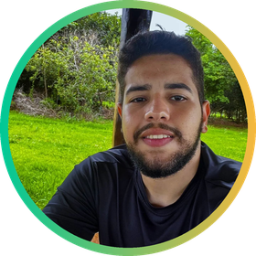

# João Victor Secundo

 

Desenvolvedor full stack em Ceres, Goiás, e fundador da [For6 Solutions](https://for6solutions.com). 
Crio sites, sistemas web e aplicativos sob medida, da conversa com o cliente ao deploy e à manutenção. 
Curso Sistemas de Informação no IF Goiano, já liderei equipes como Scrum Master e dei aula de tecnologia para crianças.

 
 
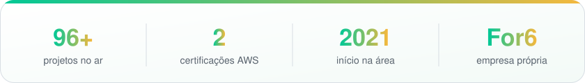

## Experiência

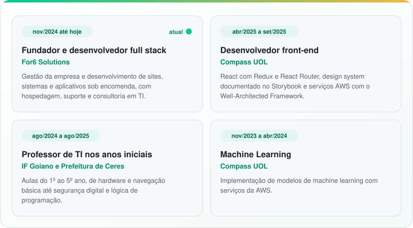

## Projetos no ar

<a href="https://saudesemespera.com">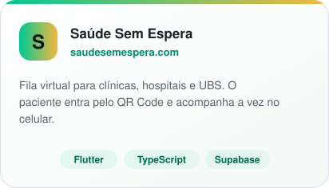</a>
<a href="https://gabrielsecundo.for6solutions.com">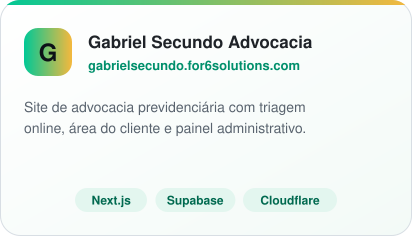</a>
<a href="https://colegioimaculadaceres.com.br">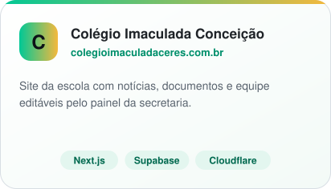</a>
<a href="https://kidsflow.for6solutions.com">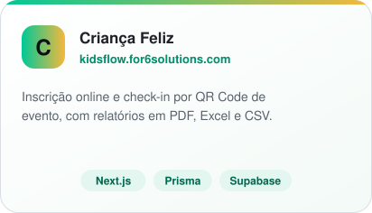</a>
<a href="https://secundo.dev">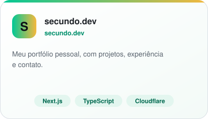</a>
<a href="https://for6solutions.com">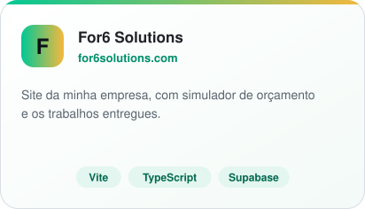</a>

Também desenvolvi o sistema do Posto de Vendas do IF Goiano, a automação do setor de Equoterapia e chatbots integrados à AWS.

## Formação e certificações

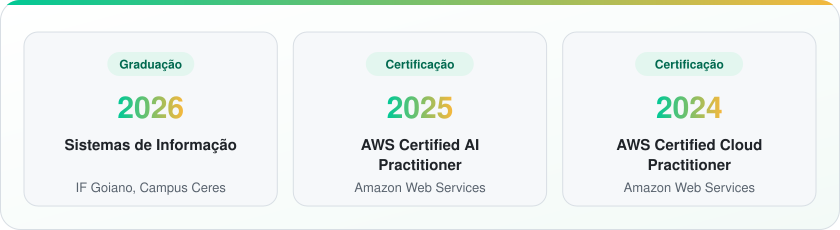

Idiomas: português nativo e inglês intermediário.

## Stack

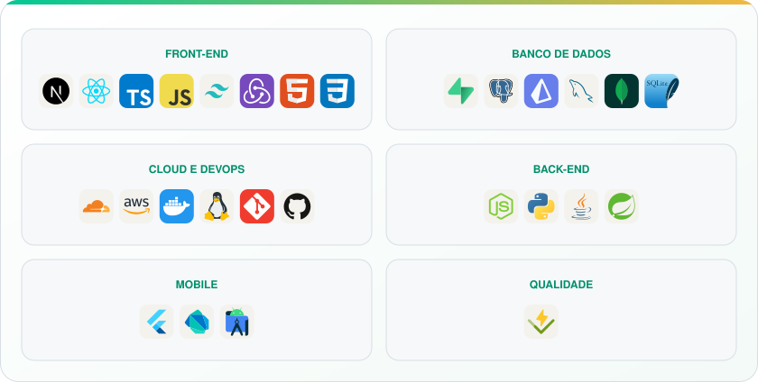

## Contribuições

